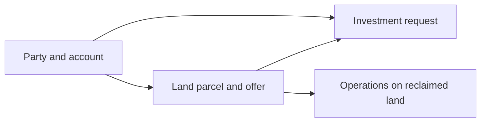
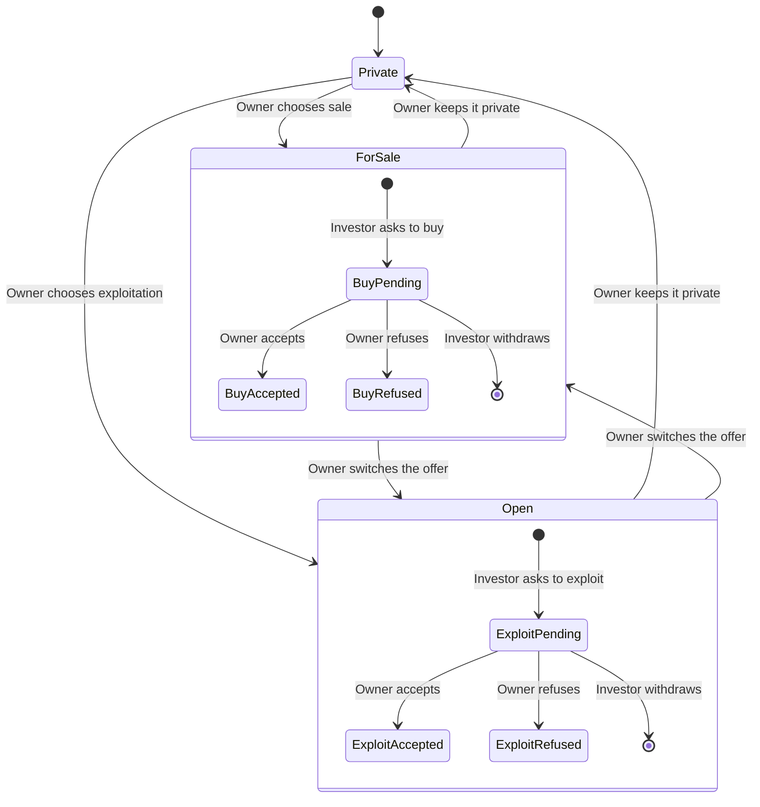
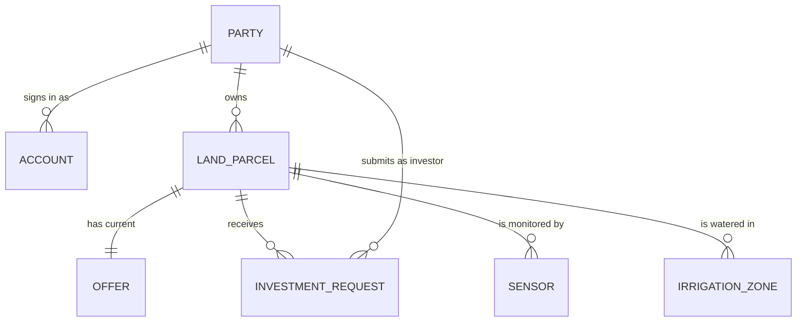

# Namaa — Conceptual Data Model

**Namaa : Toward Sustainable Investment of Underutilized Lands in the Kingdom.**

A digital platform that seamlessly and transparently connects underutilized lands with reclamation, rehabilitation, and investment opportunities.

| | |
|---|---|
| Document | Conceptual Data Model (CDM) |
| System | Namaa portal |
| Status | Matches the current demo |
| Language | English, with the Arabic names used in the product |

This model describes business concepts and the rules that connect them. It is not a database schema.

## 1. Purpose

Namaa lets three kinds of party work on the same land record:

- **Government** runs the national view and decides only **public land**.
- **A proprietor** decides their own parcels: keep them private, offer them for sale, or open them for exploitation.
- **An investor** sees only what is offered, then asks to buy or to exploit.

## 2. Subject areas

| Subject area | What it holds |
|---|---|
| Party and account | Who can sign in, and which estate or office they represent |
| Land parcel and offer | A unit of land, who owns it, and whether it is private, for sale, or open for exploitation |
| Investment request | An investor’s ask to buy or exploit, and the decision on that ask |
| Operations | Sensors, irrigation, cultivation, energy, and cost on land already in the program |

The first three areas are the investment path. Operations is the government view of land that is already being reclaimed.

## 3. Party and account

### Party

A party is an organization, not a login.

| Attribute | Meaning |
|---|---|
| Party id | Stable code: `mewa`, `nakheel`, `waha`, `state`, `gulf` |
| Name | Display name in English and Arabic |
| Kind | `government`, `proprietor`, `investor`, or `public` |

`public` is the state as landowner. The government **account** acts for that land. It is not a second owner.

| Party | Arabic name | Kind |
|---|---|---|
| MEWA Operator | مشغّل الوزارة | Government |
| Al-Nakheel Holdings | مجموعة النخيل | Proprietor |
| Waha Desert Estates | واحة العقارية | Proprietor |
| Public land (state) | أرض عامة (الدولة) | Public |
| Gulf Green Capital | الخليج الأخضر | Investor |

### Account

An account is how a person enters the portal on behalf of one party.

| Attribute | Meaning |
|---|---|
| Email | Sign-in name |
| Role | `government`, `owner`, or `investor` |
| Party | The party this session acts for |

Demo accounts, all with password `namaa`:

| Email | Role | Party |
|---|---|---|
| gov@namaa.sa | Government | MEWA |
| owner@namaa.sa | Proprietor | Al-Nakheel Holdings |
| waha@namaa.sa | Proprietor | Waha Desert Estates |
| investor@namaa.sa | Investor | Gulf Green Capital |

One party can have many accounts later. In the demo, each party has one.

## 4. Land parcel and offer

### Land parcel

A parcel is one registered unit inside the Kingdom.

| Attribute | Meaning |
|---|---|
| Parcel id | Such as `U-012` |
| Owner | A proprietor party, or public land |
| Region | Riyadh, Jeddah, Madinah, Eastern Province, Tabuk, AlUla, Najran, Qassim, Jazan, Al Jawf |
| Location | Latitude and longitude, inland |
| Area | Hectares |
| Power | Megawatts planned or installed |
| Crop | Dates, vegetables, forage, or pilot |
| Cultivation status | `active` cultivation, `prepared`, or `prep` (under preparation) |
| Offer | The current commercial position of the parcel |

National targets sit above the parcel: 10,000 ha reclamation target, planned unit count, and reclaimed area. Those figures describe the program. They are not attributes of one parcel.

### Offer

The offer is the current choice on a parcel. There is one current offer, not a history.

| Offer | Arabic | Who may set it | What an investor sees |
|---|---|---|---|
| `private` | أبقِها خاصة | The owner | Nothing. The parcel is hidden. |
| `sale` | بيع | The owner | The parcel, with **Buy the land** |
| `exploit` | مفتوح للاستغلال | The owner | The parcel, with **Exploit the land** |

**Owner** means:

- the proprietor, for a private estate (مجموعة النخيل or الواحة العقارية)
- the government, for public land only

The government cannot change the offer on a private parcel. A proprietor cannot change another estate’s parcels.

## 5. Investment request

A request is one investor asking for one parcel.

| Attribute | Meaning |
|---|---|
| Parcel | The land asked for |
| Investor | The party asking |
| Kind | `buy` or `exploit` |
| Status | `pending`, `accepted`, or `refused` |

Rules:

- A buy request is allowed only while the offer is **for sale**.
- An exploitation request is allowed only while the offer is **open for exploitation**.
- An investor has at most one live request on a parcel. A refused request can be sent again.
- While the request is pending, the investor may withdraw it. Withdraw removes it.
- Accept and refuse are recorded on the same request. The proprietor and the investor both see that result.

Who may decide:

| Land | Who accepts or refuses |
|---|---|
| Private parcel | That parcel’s proprietor only |
| Public land | Government only |

The government can read that private land is offered. It does not accept or refuse those requests.

## 6. How a deal moves

“Owner” in this diagram is the proprietor for private land and the government for public land.

Changing the offer does not delete an existing request. The investor then sees that the parcel is no longer offered for that kind of deal, until the owner accepts, refuses, or the investor withdraws.

## 7. Relationships

| From | To | Rule |
|---|---|---|
| Party | Account | An account acts for exactly one party |
| Party | Land parcel | A parcel has exactly one owner |
| Land parcel | Offer | Exactly one current offer |
| Land parcel | Investment request | Zero or many requests, one per investor |
| Party (investor) | Investment request | The investor who sent it |
| Land parcel | Sensor, irrigation | Operational readings for land already in the program |

## 8. Operations subject area

These concepts support the government dashboard. They do not decide a sale or an exploitation.

| Concept | What it records |
|---|---|
| Sensor | A field device: id, location, type, and status `online`, `degraded`, or `offline` |
| Irrigation zone | A group of units, duty cycle, water saved, and next run |
| Cultivation module | A controlled-environment crop with climate and yield |
| Energy reading | Generation, pumping load, and battery across the day |
| Cost line | Planned and actual capital or operating cost |
| Program impact | Reclaimed hectares, water saved, and avoided emissions for the program as a whole |

Sensors are filtered on the map by status. A sensor reading does not change who owns a parcel or whether it is for sale.

## 9. What each role is allowed to see

| Concept | Government | Proprietor | Investor |
|---|---|---|---|
| All parcels on the national map | Yes | No, only their estate | No, only parcels offered for sale or exploitation |
| Set the offer | Public land only | Their parcels only | No |
| Accept or refuse a request | Public land only | Their parcels only | No |
| Send a buy or exploitation request | No | No | Yes, when the offer matches |
| Withdraw a pending request | No | No | Their own request |
| Sensors, irrigation, energy, cost | Yes | No | No |

## 10. Demo parcels

| Parcel | Owner | Region | Crop | Cultivation |
|---|---|---|---|---|
| U-012 | مجموعة النخيل | Riyadh | Dates | Active |
| U-033 | مجموعة النخيل | Jeddah | Vegetables | Active |
| U-067 | مجموعة النخيل | Eastern Province | Forage | Active |
| U-188 | مجموعة النخيل | Qassim | Vegetables | Active |
| U-041 | الواحة العقارية | Madinah | Forage | Prepared |
| U-102 | الواحة العقارية | AlUla | Dates | Prepared |
| U-214 | الواحة العقارية | Jazan | Forage | Active |
| U-088 | Public land | Tabuk | Pilot | Under preparation |
| U-140 | Public land | Najran | Pilot | Under preparation |
| U-301 | Public land | Al Jawf | Pilot | Under preparation |

The starting offer is for sale on U-012, open for exploitation where the parcel was already opened to investors, and private otherwise. People can change those offers in the portal. The changed offer and any requests stay in the browser for that demo.
